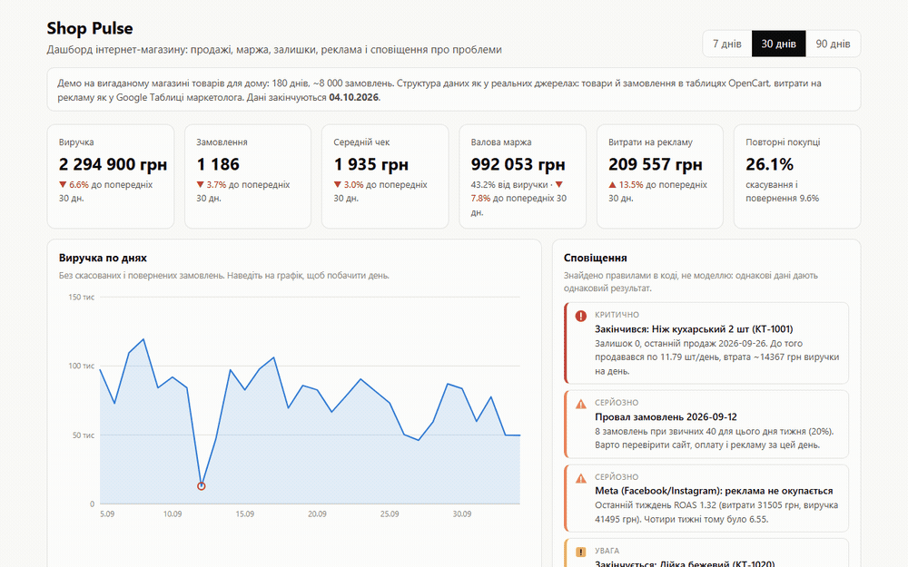
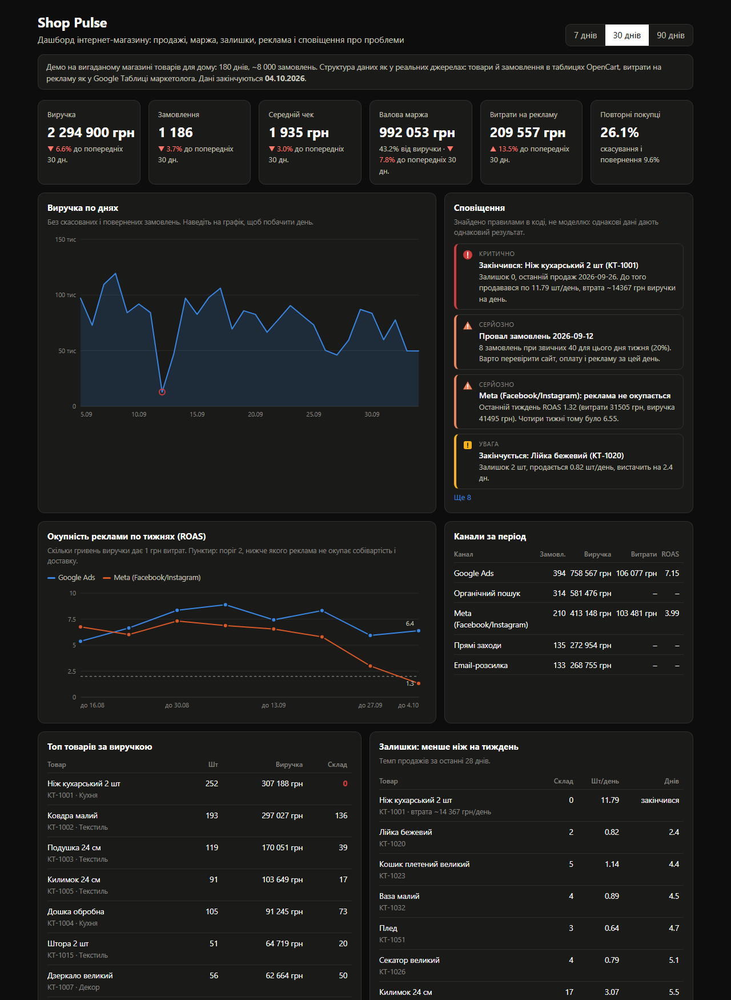
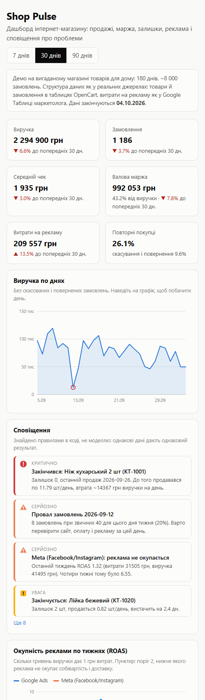

[English](README.md) | **Українська**

# Shop Pulse

Дашборд інтернет-магазину, що поєднує дані магазину (замовлення й товари OpenCart) з витратами
на рекламу (Google Таблиця маркетолога), піднімає сповіщення, коли щось ламається, і дає власнику
ставити питання звичайною українською. ШІ-консультант не може тихо вигадати число: після кожної
відповіді код звіряє кожне число й дату з даними, які консультант справді отримав.

**Живе демо:** https://shop-pulse-smoky.vercel.app



Магазин вигаданий, дані згенеровані (180 днів, 8 000+ замовлень, 84 товари). Таблиці зберігають
форму справжніх джерел, тож підключення справжньої бази OpenCart означає заміну `world.py`, а не
дашборду.

## Що робить

| Частина | Як | Чому так |
|---|---|---|
| KPI | виручка, замовлення, середній чек, валова маржа, витрати на рекламу, повторні покупці, скасування; кожен порівняно з попереднім рівним періодом | саме порівняння перетворює число на сигнал |
| Сповіщення | правила в коді: хіт продажів закінчився (з втраченою виручкою на день), день із замовленнями нижче 60% медіани того ж дня тижня, платний канал з тижневим ROAS нижче 2, товари із запасом менше ніж на 7 днів | ті самі дані дають ту саму відповідь; це можна тестувати; модель ніколи не вирішує, що є проблемою |
| Окупність реклами | тижневий ROAS по каналах поруч із місячною таблицею | середнє за місяць ховає свіжий обвал (див. нижче) |
| ШІ-консультант | модель викликає 7 дозволених функцій, тих самих, що малюють дашборд, з аргументами, перевіреними Pydantic; без SQL і без доступу до бази | вона бачить лише те, що бачить власник |
| Перевірка чисел | кожне число й дата у відповіді звіряються з результатами функцій (з допуском на округлення) | вигадане чи самостійно пораховане число показується користувачу як «не знайдено в даних» |

У дані навмисно закладено три проблеми, тож правила сповіщень перевіряються на відомій відповіді:
хіт продажів закінчується 27.09, оформлення замовлення ламається 12.09 (замовлень 20% від норми),
а витрати на Meta три тижні ростуть, поки її замовлення падають. Тести перевіряють, що
спрацьовують саме ці три серйозні сповіщення і жодне інше серйозне.

## Заміри

Консультант на `openai/gpt-oss-120b` (Groq), 15 питань з відомими відповідями
([`eval/run_eval.py`](eval/run_eval.py), сирі відповіді в [`eval/results.json`](eval/results.json)):

| Метрика | Результат |
|---|---|
| Викликав потрібну для відповіді функцію | 15 / 15 |
| Відповідь містить очікуваний факт | 15 / 15 |
| Відповіді, де кожне число й дата знайдені в даних | 15 / 15 (53 перевірено, 0 не знайдено) |
| Затримка, медіана / p95 | 0.74 с / 2.5 с |
| Ціна 1 000 питань | $0.44 |

Попередній прогін дав 14/15 за фактами і за числами; обидва промахи були через те, як написана
відповідь, а не через хибні дані (дата у вигляді `12 09 2026`, товар названо без варіанта).
Перевірка тепер читає людські дати, див. нижче.

Тести: 41, без мережі й ключа API, під лімітом пам'яті 1 ГБ у Docker
(`scripts/run_tests_capped.ps1`) і в GitHub Actions.

## Де ламається / обмеження

- **Середнє за місяць збрехало про Meta.** На питання «чи окупається Meta?» перша версія
  відповіла з таблиці за 30 днів: ROAS 3.99, усе добре. Останній тиждень був 1.32. Тепер промпт
  відправляє питання про окупність і до тижневої функції, а eval вимагає `1.32` у відповіді.
  Правило в промпті слабше за код: правило сповіщень ловить це в будь-якому разі.
- **Модель рахує власні числа.** У ручному прогоні вона поділила виручку на замовлення і назвала
  середній чек 1 604 грн, якого немає ніде в даних. Перевірка це позначила. Тепер промпт
  забороняє похідні числа, але перевірка лишається, бо промпт це прохання, а не гарантія.
- **Типографіка ламала перевірку.** Модель пише нерозривні пробіли й дефіси (`2 294 900`,
  `2026‑09‑26`); без нормалізації справжні числа позначались як неперевірені. Виправлено й
  покрито тестом.
- **Дати, написані для людей, виглядали вигаданими.** У даних `2026-09-12`; модель пише `12.09`,
  `12 09` або `12 вересня`, і перша жива перевірка показала «не знайдено: 12 09» під правильною
  відповіддю. Тепер перевірка переводить їх в ISO. Цифрова форма на кшталт `4.4` вважається
  датою, лише якщо така дата є в даних, інакше перевіряється як число.
- **Допуск був занадто м'який.** Плаский ±0.5 приймав «4.7 дня», коли в даних 4.4. Тепер допуск
  дорівнює половині останнього розряду, який написала модель.
- **Один відсутній індекс коштував 5 секунд.** Частка повторних покупців рахувалась корельованим
  підзапитом на кожне замовлення; перше завантаження за 90 днів на Vercel тривало 6.4 с. Індекс
  на `(customer_id, date_added)` дав 12 мс локально.
- **Ліміти запитів живуть в одному serverless-інстансі.** 10 питань на годину з однієї адреси і
  200 на день зберігаються в пам'яті; холодний старт їх скидає. Для демо, що витрачає центи,
  достатньо, для платного продукту ні (там потрібне спільне сховище).
- Eval з 15 питань малий; він показує метод, а не гарантію.

## Що зробив би далі

1. Справжні конектори: OpenCart через базу чи API, Google Таблиці через сервісний акаунт, CRM
   магазину; синхронізація за розкладом у Postgres з ідемпотентним завантаженням за день.
2. Сповіщення в Telegram чи на пошту за розкладом, з вимиканням окремого сповіщення.
3. Зберігати кожне питання, відповідь і результат перевірки, щоб eval ріс зі справжніх питань.

## Запуск локально

```bash
pip install -r requirements-dev.txt
PYTHONPATH=src uvicorn shoppulse.web:app --port 7860
# консультант: задайте GROQ_API_KEY в оточенні (див. .env.example)
```

Стек: Python, FastAPI, SQLite (у пам'яті, будується при старті), Pydantic, httpx, SVG-графіки
вручну, Groq. Задеплоєно на Vercel як одну Python-функцію.

| Темна тема | Телефон |
|---|---|
|  |  |
